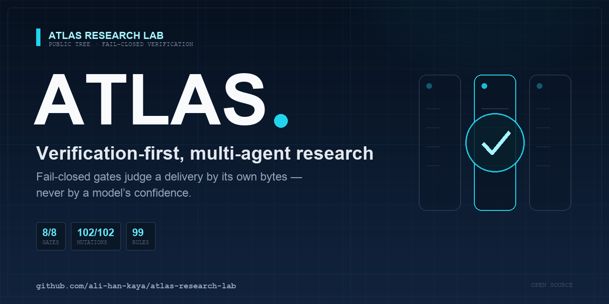

# Ali Han Kaya

I build **ATLAS**, a verification-first, multi-agent research lab whose fail-closed gates judge a delivery by its own bytes—never by a model's confidence—and whose public tree is the production mechanism itself. Explore the [ATLAS repository](https://github.com/ali-han-kaya/atlas-research-lab) and read the [English summary](https://github.com/ali-han-kaya/atlas-research-lab/blob/main/README.en.md).
